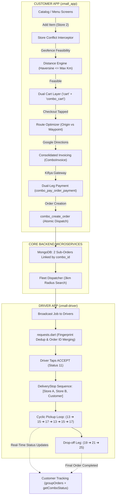
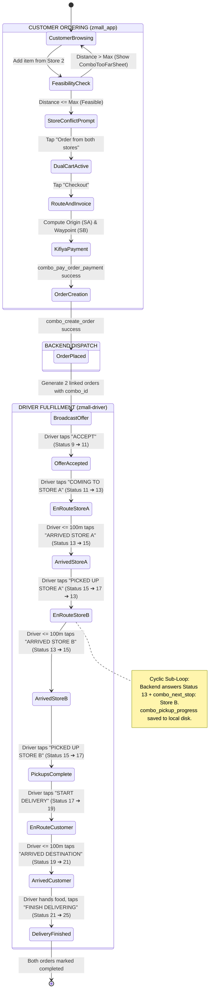

# Zmall Combo Orders: Complete End-to-End Architecture & Lifecycle Specification
## Unified Customer App (`zmall_app`) · Backend Services · Driver App (`zmall-driver`)

> **Document Type:** Master System Architecture & Full Engineering Specification  
> **Audience:** Mobile Engineers (Customer & Driver), Backend Engineers, Logistics Operators, and Tech Leads  
> **Repositories Covered:**  
> 1. **Customer App:** `zmall_app` (`/Users/apple/Desktop/etta/main_app/zmall_app`)  
> 2. **Driver App:** `zmall-driver` (`/Users/apple/Desktop/etta/zmall-driver`)  
> 3. **Core Backend Microservices:** Zmall Node.js / MongoDB Platform  
> **Scope:** Full End-to-End Lifecycle: Multi-Merchant Ingestion, Feasibility Geofencing, Dynamic Route Optimization, Dual-Leg Checkout & Payment, Backend Dispatch, Cyclic Multi-Hop Courier Fulfillment, and Real-Time Customer Status Aggregation.

---

## Table of Contents

1. [Executive Summary & Unified System Topology](#1-executive-summary--unified-system-topology)
2. [Core Architectural Models & Mental Models](#2-core-architectural-models--mental-models)
   - [2.1 Customer App: Non-Breaking Dual-Cart Storage Strategy](#21-customer-app-non-breaking-dual-cart-storage-strategy)
   - [2.2 Driver App: The `DeliveryStop` Ordered Route Abstraction](#22-driver-app-the-deliverystop-ordered-route-abstraction)
   - [2.3 Chronological Identity vs. Geographical Route Identity](#23-chronological-identity-vs-geographical-route-identity)
   - [2.4 The Single-Courier Multi-Hop Fulfillment Contract](#24-the-single-courier-multi-hop-fulfillment-contract)
3. [Mathematical Derivations & Algorithmic Foundations](#3-mathematical-derivations--algorithmic-foundations)
   - [3.1 Geodesic Proximity Verification (The Haversine Model)](#31-geodesic-proximity-verification-the-haversine-model)
   - [3.2 Route Optimization & Origin Selection Proof](#32-route-optimization--origin-selection-proof)
   - [3.3 Fallback Travel Duration & Urban Pace Model](#33-fallback-travel-duration--urban-pace-model)
   - [3.4 Driver 100-Meter Geofence Spherical Distance Formula](#34-driver-100-meter-geofence-spherical-distance-formula)
4. [Master End-to-End System State Machine](#4-master-end-to-end-system-state-machine)
5. [In-Depth Customer Application Architecture (`zmall_app`)](#5-in-depth-customer-application-architecture-zmall_app)
   - [Phase 1: Item Discovery & Store Conflict Interception](#phase-1-item-discovery--store-conflict-interception)
   - [Phase 2: Geofence Feasibility & Distance Check Engine](#phase-2-geofence-feasibility--distance-check-engine)
   - [Phase 3: Conflict Resolution & Cart Forking Logic](#phase-3-conflict-resolution--cart-forking-logic)
   - [Phase 4: Dual-Cart State Synchronization & Invalidation Engine](#phase-4-dual-cart-state-synchronization--invalidation-engine)
   - [Phase 5: Route Optimization & Google Directions Client](#phase-5-route-optimization--google-directions-client)
   - [Phase 6: Invoicing, Pricing Consolidation & Data Sanitization](#phase-6-invoicing-pricing-consolidation--data-sanitization)
   - [Phase 7: Dual-Leg Payment Processing & Kifiya Architecture](#phase-7-dual-leg-payment-processing--kifiya-architecture)
   - [Phase 8: Atomic Order Placement, Idempotency & Persistence](#phase-8-atomic-order-placement-idempotency--persistence)
6. [In-Depth Driver Application Architecture (`zmall-driver`)](#6-in-depth-driver-application-architecture-zmall-driver)
   - [Phase 9: Offer Broadcast, Deduplication & Order ID Merging](#phase-9-offer-broadcast-deduplication--order-id-merging)
   - [Phase 10: Pickup Leg 1 — Navigation to Origin (Store A)](#phase-10-pickup-leg-1--navigation-to-origin-store-a)
   - [Phase 11: The State Cycling Sub-Loop (`13 ➔ 15 ➔ 17 ➔ 13`)](#phase-11-the-state-cycling-sub-loop-13---15---17---13)
   - [Phase 12: Pickup Leg 2 — Navigation to Waypoint (Store B)](#phase-12-pickup-leg-2--navigation-to-waypoint-store-b)
   - [Phase 13: Final Drop-off Leg — Navigation to Customer](#phase-13-final-drop-off-leg--navigation-to-customer)
   - [Phase 14: Order Completion & Settlement](#phase-14-order-completion--settlement)
7. [Customer Live Tracking & Synthesized Status Engine](#7-customer-live-tracking--synthesized-status-engine)
   - [7.1 Multi-Layer Order Grouping Algorithm (`groupOrders`)](#71-multi-layer-order-grouping-algorithm-grouporders)
   - [7.2 Derived Multi-Store Status Logic (`getComboStatus`)](#72-derived-multi-store-status-logic-getcombostatus)
   - [7.3 Cross-Referenced Order Details Picker UI](#73-cross-referenced-order-details-picker-ui)
8. [Complete End-to-End API Contracts & Data Payloads](#8-complete-end-to-end-api-contracts--data-payloads)
9. [Driver Edge Cases, Crash Resilience & Defensive Engineering](#9-driver-edge-cases-crash-resilience--defensive-engineering)
10. [Comprehensive Lifecycle Status Code Matrix](#10-comprehensive-lifecycle-status-code-matrix)
11. [Component Map & Source Code Directory Reference](#11-component-map--source-code-directory-reference)
12. [Architectural Decision Records (ADRs)](#12-architectural-decision-records-adrs)

---

## 1. Executive Summary & Unified System Topology

In standard on-demand food and grocery logistics, software is designed around an inflexible **$1:1:1$ invariant**:
$$\mathbf{1\text{ Customer}} \longleftrightarrow \mathbf{1\text{ Store}} \longleftrightarrow \mathbf{1\text{ Courier}}$$

When a customer desires items from two separate merchants (e.g., hot food from a restaurant and cold drinks or groceries from a supermarket), this single-store limitation creates systemic friction across the entire platform:
1. **Customer Inconvenience:** The customer must complete two distinct checkouts, pay two full delivery charges, and coordinate with two independent drivers arriving at different times.
2. **Fleet Inefficiency:** Dispatch sends two couriers to the same customer neighborhood, doubling fuel consumption, road traffic, and platform overhead.
3. **Cart Abandonment:** In traditional single-store carts, attempting to add an item from a different store prompts a destructive alert: *"Clear your cart to add this item?"*, causing high cart churn.

The **Zmall Combo Architecture** unites the **Customer App (`zmall_app`)**, **Backend Core Services**, and **Driver App (`zmall-driver`)** into a **single, synchronized multi-merchant delivery system**:
* **In the Customer App:** The user bundles items from up to **two stores** in a non-breaking dual-cart interface, verifies geographical feasibility, and checks out with an optimized, shared delivery fee.
* **In Core Backend Services:** The platform calculates the triangular journey, generates two linked sub-orders sharing a single `combo_id`, and dispatches them as one unified task to a single courier.
* **In the Driver App:** The courier receives a single deduplicated job, navigates an ordered sequence of physical stops (`Store A` $\to$ `Store B` $\to$ `Customer`), validates arrival using 100m geofences, and executes a cyclic pickup loop without requiring new backend status codes.
* **In Downstream Tracking:** Both kitchens prepare items independently while customer live tracking synthesizes their kitchen progress and the driver's multi-stop movements into a single real-time status card.



---

## 2. Core Architectural Models & Mental Models

### 2.1 Customer App: Non-Breaking Dual-Cart Storage Strategy
In mature production applications, refactoring the primary `Cart` object into an array of merchants risks breaking dozens of dependent components, models, and payment flows.

To eliminate regression risks, `zmall_app` implements a **split-persistence strategy**:

```
┌─────────────────────────────────────────────────────────────────────────────────────────┐
│                                CLIENT LOCAL STORAGE LAYER                               │
├────────────────────────────────────────────┬────────────────────────────────────────────┤
│                   'cart'                   │                'combo_cart'                │
│            (Primary Store Cart)            │           (Secondary Store Cart)           │
├────────────────────────────────────────────┼────────────────────────────────────────────┤
│ • Holds Store 1 items & location           │ • Holds Store 2 items & location           │
│ • Existing single-store screens read as-is │ • Holds combo session tokens:              │
│ • Zero modification to legacy controllers  │   - combo_id                               │
│ • Completely backwards-compatible          │   - origin_store_id                        │
│ • Active when combo is absent or present   │   - cart_id_by_store (Map)                 │
│                                            │   - order_payment_id_by_store (Map)        │
│                                            │ • Purged when Store 2 items reach zero     │
└────────────────────────────────────────────┴────────────────────────────────────────────┘
```

#### Key Engineering Invariants:
1. **Zero Legacy Disruption:** If a user only shops at one merchant, `combo_cart` is `null`. The app executes legacy single-store checkout routines with zero performance overhead.
2. **Additive Cart Section:** The Cart screen checks for `combo_cart`. If present, it injects [ComboStoreSection](file:///Users/apple/Desktop/etta/main_app/zmall_app/lib/combo/widgets/combo_store_section.dart) beneath Store 1's items.
3. **Decoupled Lifecycle:** If the user deletes all items from Store 2, `combo_cart` is removed from storage, and the app reverts cleanly to a single-store cart without requiring a page reload.

---

### 2.2 Driver App: The `DeliveryStop` Ordered Route Abstraction
Historically, the Driver App hard-coded single-pickup assumptions across 31+ screen locations:
`request['pickup_addresses'][0]`

The combo driver architecture refactored this into an ordered sequence:
$$\mathbf{List\langle DeliveryStop \rangle}$$

```
Single Delivery : [ Stop 0: Pickup Store A, Stop 1: Customer Drop-off ]
Combo Delivery  : [ Stop 0: Pickup Store A, Stop 1: Pickup Store B, Stop 2: Customer Drop-off ]
```

#### Key Fields of `DeliveryStop`:
* `index`: Absolute 0-based position in the trip.
* `pickupNumber`: 1-based index among pickups only (`1` for Store A, `2` for Store B, `null` for Customer).
* `orderId`: The specific store's backend order ID (mandatory when sending pickup confirmation status `17`).
* `deliveryStatus`: Per-address delivery status from the backend payload.
* `isDropoff`: `true` only for the terminal customer drop-off.

---

### 2.3 Chronological Identity vs. Geographical Route Identity

A fundamental rule across both mobile codebases is the separation between browsing sequence and physical driving sequence:

* **Chronological Sequence (Store 1 vs. Store 2):**  
  The order in which the customer added items in `zmall_app`. Store 1 was added first; Store 2 was added second.
* **Geographical Sequence (Store A vs. Store B):**  
  The order in which the driver physically visits the merchants. **Store A is the Origin** (farther from the customer); **Store B is the Waypoint** (nearer to the customer).

> **The Invariant:** Store 1 is **not** necessarily Store A!  
> If the customer adds food from Store 1 and drinks from Store 2, but Store 2 is further away from the customer's home, the driver visits Store 2 first.  
> $\implies \text{Store 2} = \text{Store A (Origin)}$, $\text{Store 1} = \text{Store B (Waypoint)}$.

To ensure neither application confuses cart tokens, payment IDs, or pickup stops when the labels change based on location:
* **All Customer App mappings are keyed by permanent `store_id` strings** (`cartIdByStore[storeId]`).
* **The Driver App sorts pickups by `combo_pickup_sequence`** ($1 = \text{Origin}$, $2 = \text{Waypoint}$).

---

### 2.4 The Single-Courier Multi-Hop Fulfillment Contract

The physical fulfillment contract executed by the driver consists of **three distinct legs**:

```
 [Driver Starts] ──▶ [Leg 1: To Origin Store A] ──▶ (Collects Order A)
                            │
                     [Leg 2: To Waypoint Store B] ──▶ (Collects Order B)
                            │
                     [Leg 3: To Customer Home]    ──▶ (Delivers Both Orders)
```

1. **Leg 1 (Origin):** Driver navigates to Store A $\longrightarrow$ Enters 100m geofence $\longrightarrow$ Collects Order A.
2. **Leg 2 (Waypoint):** Driver navigates to Store B $\longrightarrow$ Enters 100m geofence $\longrightarrow$ Collects Order B.
3. **Leg 3 (Drop-off):** Driver navigates to Customer $\longrightarrow$ Enters 100m geofence $\longrightarrow$ Delivers both Order A and Order B.

---

## 3. Mathematical Derivations & Algorithmic Foundations

### 3.1 Geodesic Proximity Verification (The Haversine Model)

Before allowing a combo order, `zmall_app` checks the physical separation between Store 1 and Store 2 using the **Haversine Formula**:

Given two coordinates $(\phi_1, \lambda_1)$ and $(\phi_2, \lambda_2)$ in radians:
$$\Delta \phi = \phi_2 - \phi_1, \quad \Delta \lambda = \lambda_2 - \lambda_1$$
$$a = \sin^2\left(\frac{\Delta \phi}{2}\right) + \cos(\phi_1)\cos(\phi_2)\sin^2\left(\frac{\Delta \lambda}{2}\right)$$
$$c = 2 \cdot \arctan2\left(\sqrt{a}, \sqrt{1 - a}\right)$$
$$D = R \cdot c \quad (\text{with Earth radius } R = 6,371,000 \text{ m})$$

#### Feasibility Invariant:
$$D \le D_{\text{max}}$$
where $D_{\text{max}}$ is queried dynamically from `get_combo_max_store_distance`. If $D > D_{\text{max}}$, the combo is blocked, and [ComboTooFarDialog](file:///Users/apple/Desktop/etta/main_app/zmall_app/lib/combo/widgets/combo_too_far_dialog.dart) is shown.

---

### 3.2 Route Optimization & Origin Selection Proof

Consider two merchants $S_1, S_2$ and customer drop-off $C$.
The driver must complete one of two routing permutations:
* **Route 1:** $S_1 \longrightarrow S_2 \longrightarrow C$
* **Route 2:** $S_2 \longrightarrow S_1 \longrightarrow C$

Because road network distances between two nearby urban stores are symmetric:
$$\text{dist}(S_1, S_2) \approx \text{dist}(S_2, S_1)$$

Evaluating the total driving distances:
$$\text{Total}_1 = \text{dist}(S_1, S_2) + \text{dist}(S_2, C)$$
$$\text{Total}_2 = \text{dist}(S_2, S_1) + \text{dist}(S_1, C)$$
$$\text{Total}_1 - \text{Total}_2 = \text{dist}(S_2, C) - \text{dist}(S_1, C)$$

#### Theorem (Origin Selection):
$$\text{Total}_1 \le \text{Total}_2 \iff \text{dist}(S_2, C) \le \text{dist}(S_1, C)$$

#### Rule:
**The shorter total trip is always achieved by visiting the store that is FARTHER from the customer first ($S_A$), and ending at the store that is CLOSER to the customer ($S_B$).**

$$\text{Origin Store } (S_A) = \arg\max_{S \in \{S_1, S_2\}} \text{dist}(S, C)$$
$$\text{Waypoint Store } (S_B) = \arg\min_{S \in \{S_1, S_2\}} \text{dist}(S, C)$$

---

### 3.3 Fallback Travel Duration & Urban Pace Model

If the Google Directions API times out or is unreachable, `zmall_app` falls back to deterministic calculations:
$$D_{\text{fallback}} = \text{Haversine}(S_A, S_B) + \text{Haversine}(S_B, C)$$
$$T_{\text{fallback}} = \left(\frac{D_{\text{fallback}}}{1000}\right) \times 120 \text{ seconds } (2.0\text{ min/km})$$

---

### 3.4 Driver 100-Meter Geofence Spherical Distance Formula

In `zmall-driver`, status changes to **ARRIVED AT STORE (15)** or **ARRIVED AT DESTINATION (21)** require the driver to be physically present.

The driver app computes the distance between current GPS $(\text{lat}_D, \text{lng}_D)$ and the target stop $(\text{lat}_T, \text{lng}_T)$:
$$\Delta \text{lat} = \text{lat}_T - \text{lat}_D, \quad \Delta \text{lng} = \text{lng}_T - \text{lng}_D$$
$$D_{\text{geofence}} = \sqrt{(\Delta \text{lat} \cdot 111.32)^2 + (\Delta \text{lng} \cdot 111.32 \cdot \cos(\text{lat}_D))^2} \quad (\text{in km})$$

#### Geofence Invariant:
$$\text{Near} = (D_{\text{geofence}} \le 0.1000 \text{ km}) \implies \le 100\text{ meters}$$
If $D_{\text{geofence}} > 0.1000 \text{ km}$, status advancement is blocked, and the driver is alerted: *"You are beyond the 100-meters range from the store/destination."*

---

## 4. Master End-to-End System State Machine



---

## 5. In-Depth Customer Application Architecture (`zmall_app`)

---

### Phase 1: Item Discovery & Store Conflict Interception
1. **User Action:** The user browses catalog views in [NotificationStore](file:///Users/apple/Desktop/etta/main_app/zmall_app/lib/notifications/notification_store.dart), [ItemBody](file:///Users/apple/Desktop/etta/main_app/zmall_app/lib/item/components/body.dart), or [ProductScreen](file:///Users/apple/Desktop/etta/main_app/zmall_app/lib/product/product_screen.dart) and taps **"Add to Cart"**.
2. **Local Evaluation:**
   * If `cart` is empty: Item is saved as the primary cart in `'cart'`.
   * If `cart` exists and `cart.storeId == item.storeId`: The item belongs to the same merchant; it is appended or incremented via `Service.addOrMergeCartItem(...)`.
   * If `cart` exists and `cart.storeId != item.storeId`: A **store conflict** is detected.

---

### Phase 2: Geofence Feasibility & Distance Check Engine
Before presenting any dialog to the user, the app evaluates whether the two merchants are close enough for a single courier:

```
              User taps "Add to Cart" on different store
                                   │
               Does Cart 1 have lat/long & does Store 2 have lat/long?
                           /               \
                         No                 Yes
                        /                     \
                [FAIL-CLOSED]             Call Backend:
             Block with error:        get_combo_max_store_distance
          "Store location missing"            │
                                       Network error or success == false?
                                             /               \
                                           Yes                No
                                          /                     \
                                  [FAIL-CLOSED]           Calculate Haversine
                                Block with error:      between Store 1 & Store 2 (D)
                              "Cannot verify dist"              │
                                                          D > Max Distance?
                                                             /       \
                                                           Yes        No
                                                           /            \
                                              [BLOCKED]            Proceed to
                                         Show ComboTooFarSheet    Conflict Dialog
```

1. **Re-entrancy Guard:** A boolean mutex `_comboDistanceCheckInProgress` drops subsequent taps until the async query finishes.
2. **Fail-Closed Validation:**
   * If `cart.storeLocation` or incoming `storeLocation` lacks latitude or longitude, the check **fails closed** with an error: *"Store location unavailable. Cannot verify combo distance."*
   * If the API call times out or fails, the check **fails closed**: *"Could not verify store distance. Please try again."*
3. **Threshold Query (`ComboService.StoreDistancegetMax`):**
   * Calls `GET /api/user/get_combo_max_store_distance` to retrieve `combo_max_store_distance_km`.
4. **Distance Evaluation:**
   * If $D > D_{\text{max}}$: The action is blocked, and [ComboTooFarDialog](file:///Users/apple/Desktop/etta/main_app/zmall_app/lib/combo/widgets/combo_too_far_dialog.dart) renders a centered dialog explaining the maximum allowed distance restriction.
   * If $D \le D_{\text{max}}$: Distance check passes; execution advances to Phase 3.

---

### Phase 3: Conflict Resolution & Cart Forking Logic
The app displays [StoreConflictDialog](file:///Users/apple/Desktop/etta/main_app/zmall_app/lib/combo/widgets/store_conflict_dialog.dart):

```
┌─────────────────────────────────────────────────────────────┐
│                      Different Store                        │
├─────────────────────────────────────────────────────────────┤
│ You already have items from [Store 1] in your cart.         │
│ What would you like to do?                                  │
│                                                             │
│   [ Order from both stores ]   <-- Starts Combo Flow        │
│   [ Clear cart & add this  ]   <-- Legacy Single Store      │
│   [ Cancel ]                   <-- Dismisses                │
└─────────────────────────────────────────────────────────────┘
```

* **If user selects "Clear":** Clears `'cart'` and `'combo_cart'` and creates a fresh single-store cart with the new item.
* **If user selects "Cancel":** Closes dialog; carts remain untouched.
* **If user selects "Order from both stores":**
  1. Checks `ComboCart.canStartWith(firstCart)`.
  2. If eligible, calls `ComboCart.start(...)`.
  3. Store 2's item is stored in local storage under `'combo_cart'`, while `'cart'` remains untouched.
  4. Shows a success banner: *"Item added to combo order"*.

---

### Phase 4: Dual-Cart State Synchronization & Invalidation Engine
In [CartScreen](file:///Users/apple/Desktop/etta/main_app/zmall_app/lib/cart/components/body.dart):
* Store 1's items are displayed using standard item rows.
* [ComboStoreSection](file:///Users/apple/Desktop/etta/main_app/zmall_app/lib/combo/widgets/combo_store_section.dart) renders Store 2 directly beneath:
  * Section header: `"Second store · same delivery"`.
  * `"Add more?"` shortcut navigating to Store 2's catalog.
  * Item tiles with quantity controls and delete buttons.
  * Store 2's subtotal.

#### The Cache Invalidation Rule:
Whenever items or quantities in Store 2 are modified:
1. `comboCart.second.items` updates locally.
2. `comboCart.resetServerState()` is invoked.
3. This purges `cartIdByStore`, `orderPaymentIdByStore`, and `originStoreId`.
4. **Why?** Any item change modifies order weight, total cost, and server price hashes. Purging cached IDs forces the app to re-sync with the server before payment.
5. If Store 2's items reach zero, `ComboCart.clear()` deletes `'combo_cart'`, instantly returning the screen to a single-store layout.

---

### Phase 5: Route Optimization & Google Directions Client
When the customer advances from [DeliveryScreen](file:///Users/apple/Desktop/etta/main_app/zmall_app/lib/delivery/delivery_screen.dart):
1. Runs a final distance check verifying the two stores are still within range.
2. Calls `computeComboRoute(...)` in [combo_route.dart](file:///Users/apple/Desktop/etta/main_app/zmall_app/lib/combo/combo_route.dart):
   * Compares straight-line distances from each merchant to the customer.
   * Farther store is assigned as `originStoreId` ($S_A$).
   * Nearer store is assigned as `waypointStoreId` ($S_B$).
3. Queries Google Directions API:
   $$\text{Origin: } S_A \longrightarrow \text{Waypoint: } S_B \longrightarrow \text{Destination: } \text{Customer}$$
4. Extracts driving distance (meters) and duration (seconds).
5. If the mapping API is unreachable, falls back to deterministic straight-line calculations ($120\text{ s/km}$).

---

### Phase 6: Invoicing, Pricing Consolidation & Data Sanitization
The app calls `ComboService.getInvoice`:
$$\text{POST } \texttt{/api/user/combo\_get\_order\_cart\_invoice}$$

#### 1. Security Sanitization (`StoreFlags`)
Raw backend store payloads contain internal merchant credentials, bank details, and admin tokens. The client parses the response through `StoreFlags`, extracting only safe operational fields:
* `onlyCashless`
* `onlyScheduled`
* `onlyPickup`
* `isBusy`
* `minOrderPrice`
* `deliveryTime` / `deliveryTimeMax`

#### 2. Business Rule Pre-Payment Guards
* **Busy Store Guard:** If `inv.anyStoreBusy == true`, checkout stops:  
  *`"${inv.busyStoreName} is currently busy. Please try again later."`*
* **Scheduled Order Guard:** If `inv.onlyScheduled == true`, checkout stops:  
  *`"One of the stores only accepts scheduled orders. Combo orders cannot be scheduled yet."`*
* **Pickup-Only Guard:** If `inv.onlyPickup == true`, checkout stops:  
  *`"One of the stores only accepts self-pickup, which is not supported for combo orders."`*

#### 3. Breakdown Display in `ComboCheckoutScreen`
[ComboCheckoutScreen](file:///Users/apple/Desktop/etta/main_app/zmall_app/lib/combo/combo_checkout_screen.dart) renders:
* **Pickup 1 Card:** Store A name, items, and subtotal.
* **Pickup 2 Card:** Store B name, items, and subtotal.
* **Summary Card:** Items total, single combined delivery fee, assigned vehicle, ETA range, and grand total (`combinedUserPay`).

---

### Phase 7: Dual-Leg Payment Processing & Kifiya Architecture
The user taps "Proceed to Payment", opening [KifiyaScreen](file:///Users/apple/Desktop/etta/main_app/zmall_app/lib/kifiya/kifiya_screen.dart) with `isCombo: true` and [ComboPaymentContext](file:///Users/apple/Desktop/etta/main_app/zmall_app/lib/models/combo_payment_context.dart).

#### 1. Payment Options
In Phase 1, combo orders support:
* **Cash on Delivery**
* **In-App Wallet**
*(Digital gateways are planned for Phase 2).*

#### 2. Dual-Leg Authorization (`combo_pay_order_payment`)
* If Wallet is selected, the app calls `change_user_wallet_status(is_use_wallet: true)`.
* The payment request submits:
  ```json
  {
    "store_a_order_payment_id": "...",
    "store_b_order_payment_id": "...",
    "is_payment_mode_cash": true,
    "order_type": 7,
    "otp": ""
  }
  ```
* The backend settles both payment records in a single coordinated transaction.

---

### Phase 8: Atomic Order Placement, Idempotency & Persistence
Following payment confirmation, the app finalizes order creation:
$$\text{POST } \texttt{/api/user/combo\_create\_order}$$
Passing `combo_id`, `store_a_cart_id`, and `store_b_cart_id`.

#### 1. Idempotency & Retry Loop
Network dropouts on mobile can lose HTTP responses even after orders are created on the server. The client protects against this with a **3x retry policy with exponential backoff**:
* If the backend returns duplicate order indicators, the client treats it as **success**, preventing double-charges and lost carts.

#### 2. Cleanup & Local History Persistence
Upon confirmation:
1. `Service.remove('cart')` clears Store 1.
2. `ComboCart.clear()` clears Store 2.
3. The returned order IDs and `combo_id` are saved to `'combo_orders'` in local storage:
   ```json
   {
     "combo_id": "...",
     "order_ids": ["65a...", "65b..."],
     "order_unique_ids": [470721, 470722],
     "created_at": "2026-10-07T12:00:00Z"
   }
   ```
4. This guarantees that even if network drops during history sync, the customer's device remembers both order IDs belong to a single combo.

---

## 6. In-Depth Driver Application Architecture (`zmall-driver`)

---

### Phase 9: Offer Broadcast, Deduplication & Order ID Merging

When the backend generates two linked sub-orders, its fleet dispatch engine broadcasts the job to couriers within a 3km radius.

#### The Backend Duplication Problem:
Because the database contains two distinct sub-orders (e.g., Order `#470605` for Store A and Order `#470606` for Store B), MongoDB aggregation pipelines return **two separate entries** in `orderData['requests']`. Displaying both cards would confuse the driver into thinking there are two independent delivery tasks.

#### The Client-Side Deduplication Solution ([requests.dart](file:///Users/apple/Desktop/etta/zmall-driver/lib/models/requests.dart)):
1. The driver app calculates a composite fingerprint for incoming delivery requests:
   $$\text{Fingerprint} = \text{sorted}(\text{lowercase}(\text{Store Names})) + \text{Drop-off GPS}$$
2. When the duplicate record is detected, the app skips adding a second card.
3. **Order ID Annotation (`annotateOrderId`):**  
   The app extracts `order_id` from the duplicate record and saves it onto `pickup_addresses[seq - 1]['order_id']` on the main card.
4. The order numbers are combined into a single display label (e.g., `"470605 + 470606"`).

---

### Phase 10: Pickup Leg 1 — Navigation to Origin (Store A)

```
 [Driver Accepts (11)] ──▶ [COMING TO STORE A (13)] ──▶ [ARRIVED STORE A (15)] ──▶ [PICKED UP (17)]
```

1. **Offer Acceptance:** Driver taps "ACCEPT". The app sends status **`11 (DELIVERY_MAN_ACCEPTED)`**.
2. **Heading to Store A:** Driver taps **"COMING TO STORE A"**. The app sends status **`13 (DELIVERY_MAN_COMING)`**.
3. **Arrival at Store A:**  
   * The app checks the 100m geofence against Store A.
   * When within 100m, driver taps **"ARRIVED STORE A"**.
   * App sends status **`15 (DELIVERY_MAN_ARRIVED)`**.

---

### Phase 11: The State Cycling Sub-Loop (`13 ➔ 15 ➔ 17 ➔ 13`)

This cyclic sub-loop allows multi-store pickups without introducing new status codes into legacy backend systems:

```
                    Driver taps "PICKED UP STORE A"
                                 │
                   Send Status 17 + Store A order_id
                                 │
                      Backend evaluates combo state:
                    Store A picked up, Store B remains!
                                 │
               Backend answers delivery_status: 13
                  along with combo_next_stop: Store B
                                 │
                 App saves combo_pickup_progress = Store B
                                 │
                UI changes to "COMING TO STORE B" (Status 13)
```

#### Why `order_id` is required for Status 17:
Status 13 ("COMING") and Status 15 ("ARRIVED") represent physical driver movement. But **Status 17 ("PICKED UP") is a legal and inventory transfer**. The backend needs to know *which* store's items were collected, so sending `order_id` is mandatory for Status 17 in multi-store orders.

#### Handling `ORDER_NOT_READY`:
If the driver taps "PICKED UP" before the merchant marks the order as prepared:
* Backend returns `{ success: false, error_code: "ORDER_NOT_READY" }`.
* The driver app detects `_isOrderNotReady`.
* State does not change; the button remains on "PICKED UP".
* The driver receives a toast: `"<Store> has not marked the order Ready yet. Please wait and try again."`

---

### Phase 12: Pickup Leg 2 — Navigation to Waypoint (Store B)

1. **Heading to Store B:** UI displays **"ARRIVED STORE B"** with status set to `13`.
2. **Arrival at Store B:**
   * Geofence evaluates distance against Store B's coordinates.
   * When within 100m, driver taps **"ARRIVED STORE B"**.
   * App sends status **`15 (DELIVERY_MAN_ARRIVED)`**.
3. **Pickup Confirmation for Store B:**
   * Driver collects the second order and taps **"PICKED UP STORE B"**.
   * App sends status **`17`** along with Store B's `order_id`.
   * The backend recognizes that all pickups are complete and returns overall `delivery_status: 17`.
   * The app clears `combo_pickup_progress` from disk.
   * The UI updates to **"START DELIVERY"**.

---

### Phase 13: Final Drop-off Leg — Navigation to Customer

```
 [START DELIVERY (19)] ──▶ [ARRIVED DESTINATION (21)] ──▶ [FINISH DELIVERING (25)]
```

1. **En Route to Customer:** Driver taps **"START DELIVERY"**. The app sends status **`19 (DELIVERY_MAN_STARTED_DELIVERY)`**.
2. **Arrival at Customer:**
   * Geofence evaluates distance against customer drop-off coordinates.
   * When within 100m, driver taps **"ARRIVED DESTINATION"**.
   * App sends status **`21 (DELIVERY_MAN_ARRIVED_AT_DESTINATION)`**.

---

### Phase 14: Order Completion & Settlement

1. The driver hands both packages to the customer and collects payment if cash.
2. Driver taps **"FINISH DELIVERING"**.
3. App calls `APIService.completeOrder(requestId)`.
4. Backend marks both linked sub-orders as **`25 (FINAL_ORDER_COMPLETED)`**.
5. The order is removed from the driver's active orders list.

---

## 7. Customer Live Tracking & Synthesized Status Engine

### 7.1 Multi-Layer Order Grouping Algorithm (`groupOrders`)
When `zmall_app` fetches active orders or order history, the server returns flat lists of orders. The app groups them using [groupOrders](file:///Users/apple/Desktop/etta/main_app/zmall_app/lib/orders/models/combo_order_entry.dart):
```
for each raw order:
  resolve combo_id from:
    1. order['combo_id']
    2. order['order_payment_detail']['combo_id']
    3. local storage 'combo_orders'
  
  if combo_id found:
    group under OrderEntry.combo(combo_id, [order1, order2])
  else:
    keep as OrderEntry.single(order)
```

### 7.2 Derived Multi-Store Status Logic (`getComboStatus`)
Because Store A and Store B prepare food independently, their internal status codes may diverge. The client computes a single synthesized status for the customer:

```
                          ┌───────────────────────────┐
                          │    Evaluate Child Orders  │
                          └─────────────┬─────────────┘
                                        │
                         Are BOTH orders cancelled (>= 100)?
                                  /           \
                                Yes            No
                                /               \
                   [Status: Cancelled]     Is ONE order cancelled (>= 100)?
                                                   /              \
                                                 Yes               No
                                                 /                  \
                            [Status: Store A cancelled ·]    Are BOTH orders completed (25)?
                            [    Store B in progress    ]           /            \
                                                                  Yes             No
                                                                  /                \
                                                         [Status: Completed]    Is a courier assigned?
                                                                               (delivery_status >= 9)
                                                                                       /        \
                                                                                     Yes         No
                                                                                     /            \
                                                                            [Status: Courier]  [Status: Reflect status]
                                                                            [  in progress  ]  [of SLOWER store's prep]
```

### 7.3 Cross-Referenced Order Details Picker UI
* **Order Card:** [ComboOrderCard](file:///Users/apple/Desktop/etta/main_app/zmall_app/lib/orders/components/combo_order_card.dart) renders dual store avatars side by side, combined merchant titles (`"Burger House + Fresh Mart"`), both order reference numbers (`"#470721, #470722"`), and the synthesized status badge.
* **Order Picker:** Tapping the card opens a bottom-sheet picker allowing the user to view detailed receipts for either individual store.
* **Cross-Reference Banner:** Inside [OrderDetail](file:///Users/apple/Desktop/etta/main_app/zmall_app/lib/orders/components/order_detail.dart), an informational banner explicitly indicates that the order is part of a combo delivery.

---

## 8. Complete End-to-End API Contracts & Data Payloads

### 1. Distance Feasibility Query
* **Endpoint:** `GET /api/user/get_combo_max_store_distance`
* **Query Params:** `store_a_id`, `store_b_id`, `user_id`, `server_token`
* **Response:**
  ```json
  {
    "success": true,
    "combo_max_store_distance_km": 5.0
  }
  ```

### 2. Cart Synchronization
* **Endpoint:** `POST /api/user/combo_add_item_in_cart`
* **Response:**
  ```json
  {
    "success": true,
    "combo_id": "combo_888",
    "store_a": { "store_id": "id_1", "cart_id": "cart_aaa" },
    "store_b": { "store_id": "id_2", "cart_id": "cart_bbb" }
  }
  ```

### 3. Consolidated Invoicing
* **Endpoint:** `POST /api/user/combo_get_order_cart_invoice`
* **Response:**
  ```json
  {
    "success": true,
    "combo_id": "combo_888",
    "combined_delivery_price": 120.0,
    "combined_user_pay_payment": 850.0,
    "store_a": {
      "success": true,
      "order_payment": {
        "_id": "pay_1",
        "unique_id": 470721,
        "store_id": "origin_id",
        "cart_id": "cart_aaa",
        "total_order_price": 500.0,
        "total_delivery_price": 60.0,
        "user_pay_payment": 560.0
      },
      "store": {
        "_id": "origin_id",
        "name": "Burger House",
        "is_store_busy": false,
        "accept_only_cashless_payment": false
      },
      "vehicles": [{ "_id": "veh_moto", "vehicle_name": "Motorbike" }]
    },
    "store_b": {
      "success": true,
      "order_payment": {
        "_id": "pay_2",
        "unique_id": 470722,
        "store_id": "waypoint_id",
        "cart_id": "cart_bbb",
        "total_order_price": 230.0,
        "total_delivery_price": 60.0,
        "user_pay_payment": 290.0
      },
      "store": {
        "_id": "waypoint_id",
        "name": "Fresh Mart",
        "is_store_busy": false,
        "accept_only_cashless_payment": false
      }
    }
  }
  ```

### 4. Dual Payment Authorization
* **Endpoint:** `POST /api/user/combo_pay_order_payment`
* **Request:**
  ```json
  {
    "user_id": "...",
    "server_token": "...",
    "store_a_order_payment_id": "pay_1",
    "store_b_order_payment_id": "pay_2",
    "is_payment_mode_cash": true,
    "order_type": 7,
    "otp": ""
  }
  ```

### 5. Final Order Creation
* **Endpoint:** `POST /api/user/combo_create_order`
* **Request:**
  ```json
  {
    "user_id": "...",
    "server_token": "...",
    "combo_id": "combo_888",
    "store_a_cart_id": "cart_aaa",
    "store_b_cart_id": "cart_bbb",
    "is_user_pick_up_order": false,
    "order_from": "android"
  }
  ```
* **Response:**
  ```json
  {
    "success": true,
    "combo_id": "combo_888",
    "order_unique_ids": [470721, 470722]
  }
  ```

### 6. Driver Status Updates
* **Endpoint:** `POST /api/provider/change_request_status`
* **Request:**
  ```json
  {
    "provider_id": "...",
    "server_token": "...",
    "request_id": "req_12345",
    "delivery_status": 17,
    "order_id": "order_store_a_id"
  }
  ```
* **Response (Store A Picked Up):**
  ```json
  {
    "success": true,
    "delivery_status": 13,
    "combo_next_stop": 2
  }
  ```

---

## 9. Driver Edge Cases, Crash Resilience & Defensive Engineering

### 9.1 Mid-Trip Phone Reboot or App Crash Resilience
* **Problem:** If the driver's phone dies while driving between Store A and Store B, the app reopens with `delivery_status: 13`.
* **Solution:** The driver app uses 3-tier signal resolution:
  1. `combo_next_stop` returned by the server.
  2. Per-stop `pickup_addresses[i]['delivery_status'] >= 17`.
  3. Local disk storage: `combo_pickup_progress` saved in `SharedPreferences`.
* **Result:** Active stop restores to Store B. The driver is **never** sent backward to Store A.

### 9.2 Mid-Trip Store Cancellation
* **Scenario:** Store B cancels while the driver is delivering Store A's food.
* **Behavior:**
  * The backend sets `order['combo'] = null`.
  * `isActiveCombo(order)` evaluates to `false`.
  * Store B is dropped from the route, and the driver is directed immediately to customer drop-off.

### 9.3 Offline Tap Recovery
* If the driver taps "PICKED UP" in an underground parking lot without cellular coverage, the request times out without modifying local state. The button remains on "PICKED UP", allowing the driver to tap again once back in coverage without desynchronizing state.

### 9.4 Defensive Status Fallback ("Update App")
* Unrecognized status codes render an `"UPDATE APP"` button in `blueGrey` with an alert: *"This delivery has a status this app version does not support. Please update the app."* This prevents illegal status transitions.

---

## 10. Comprehensive Lifecycle Status Code Matrix

| Code | Status Constant | Customer App Label | Driver App Button Copy | Transition Trigger / Action |
|:---:|:---|:---|:---|:---|
| **1** | `ORDER_CREATED` | *Waiting for store to accept* | - | Customer placed order. |
| **3** | `ORDER_ACCEPTED` | *Store preparing order* | - | Merchant kitchen confirmed order. |
| **7** | `ORDER_READY` | *Order ready for pickup* | - | Food packaged and ready. |
| **9** | `DELIVERY_MAN_NEW_DELIVERY` | *Finding nearby courier* | *Popup Offer Card* | Dispatched to couriers within 3km. |
| **11** | `DELIVERY_MAN_ACCEPTED` | *Courier assigned* | `"COMING TO <Store A>"` | Driver accepted job. |
| **13** | `DELIVERY_MAN_COMING` | *Courier heading to store* | `"ARRIVED <Store>"` | Driver en route to active pickup stop. |
| **15** | `DELIVERY_MAN_ARRIVED` | *Courier at store* | `"PICKED UP <Store>"` | Driver within 100m of store. |
| **17** | `DELIVERY_MAN_PICKED_ORDER` | *Order picked up* | `"START DELIVERY"` | Driver picked up order. Carries `order_id`. |
| **19** | `DELIVERY_MAN_STARTED_DELIVERY`| *Courier heading to you* | `"ARRIVED DESTINATION"` | Driver en route to customer. |
| **21** | `DELIVERY_MAN_ARRIVED_AT_DESTINATION` | *Courier arrived at doorstep* | `"FINISH DELIVERING"` | Driver within 100m of customer. |
| **25** | `FINAL_ORDER_COMPLETED` | *Completed* | - | Customer received order. |
| **100+**| `ORDER_CANCELLED` | *Cancelled* | - | Cancelled by store, driver, or support. |

---

## 11. Component Map & Source Code Directory Reference

### Customer App Repository (`zmall_app`)
* **[combo_cart.dart](file:///Users/apple/Desktop/etta/main_app/zmall_app/lib/combo/models/combo_cart.dart)** — Data model and local storage management for Store 2.
* **[combo_service.dart](file:///Users/apple/Desktop/etta/main_app/zmall_app/lib/combo/services/combo_service.dart)** — HTTP communication for all four combo endpoints & distance checking.
* **[combo_route.dart](file:///Users/apple/Desktop/etta/main_app/zmall_app/lib/combo/combo_route.dart)** — Geo-routing logic, origin/waypoint classification, and Directions API client.
* **[combo_invoice.dart](file:///Users/apple/Desktop/etta/main_app/zmall_app/lib/models/combo_invoice.dart)** — Strongly typed invoice model, StoreFlags sanitization, business guards.
* **[combo_payment_context.dart](file:///Users/apple/Desktop/etta/main_app/zmall_app/lib/models/combo_payment_context.dart)** — DTO bundling Store A & Store B payment context.
* **[combo_too_far_dialog.dart](file:///Users/apple/Desktop/etta/main_app/zmall_app/lib/combo/widgets/combo_too_far_dialog.dart)** — Bottom sheet explaining distance limits when stores are too far apart.
* **[store_conflict_dialog.dart](file:///Users/apple/Desktop/etta/main_app/zmall_app/lib/combo/widgets/store_conflict_dialog.dart)** — Modal offering the choice to start a combo or replace the cart.
* **[combo_store_section.dart](file:///Users/apple/Desktop/etta/main_app/zmall_app/lib/combo/widgets/combo_store_section.dart)** — Cart section displaying Store 2's items, subtotals, and controls.
* **[combo_checkout_screen.dart](file:///Users/apple/Desktop/etta/main_app/zmall_app/lib/combo/combo_checkout_screen.dart)** — Multi-stop summary view with combined pricing, ETA, and pickup breakdown.
* **[combo_order_entry.dart](file:///Users/apple/Desktop/etta/main_app/zmall_app/lib/orders/models/combo_order_entry.dart)** — Multi-store order grouping algorithm and derived status synthesis.
* **[combo_order_card.dart](file:///Users/apple/Desktop/etta/main_app/zmall_app/lib/orders/components/combo_order_card.dart)** — Card widget for combo orders in active orders and history.

### Driver App Repository (`zmall-driver`)
* **[`lib/models/delivery_stop.dart`](file:///Users/apple/Desktop/etta/zmall-driver/lib/models/delivery_stop.dart)** — Ordered multi-hop trip abstraction model and sequence sorter.
* **[`lib/models/requests.dart`](file:///Users/apple/Desktop/etta/zmall-driver/lib/models/requests.dart)** — Delivery request models, fingerprint deduplication, and order ID annotation.
* **[`lib/screens/accepted_orders/accepted_orders.dart`](file:///Users/apple/Desktop/etta/zmall-driver/lib/screens/accepted_orders/accepted_orders.dart)** — Cyclic state machine execution, 100m geofence evaluation, and crash resilience.
* **[`lib/utils/constants.dart`](file:///Users/apple/Desktop/etta/zmall-driver/lib/utils/constants.dart)** — Core `ProviderStatus` constants and button color definitions.
* **[`lib/services/api_services.dart`](file:///Users/apple/Desktop/etta/zmall-driver/lib/services/api_services.dart)** — Driver HTTP client sending status updates with `order_id`.

---

## 12. Architectural Decision Records (ADRs)

### ADR-01: Split Local Storage Keys in Customer App
* **Decision:** Keep the primary store under `'cart'` and the secondary store under `'combo_cart'` instead of refactoring `'cart'` into a list of stores.
* **Rationale:** Refactoring `'cart'` would require rewriting hundreds of screens across the app. The split-key pattern provides 100% backward compatibility with zero regressions for single-store orders.

### ADR-02: Deferring Route Optimization to Checkout
* **Decision:** Calculate the origin/waypoint sequence during checkout on [DeliveryScreen](file:///Users/apple/Desktop/etta/main_app/zmall_app/lib/delivery/delivery_screen.dart) rather than when items are first added to the cart.
* **Rationale:** The optimal pickup sequence depends on the final customer delivery address. The customer can change their drop-off location at any time prior to checkout. Calculating routes beforehand would result in stale calculations and unnecessary API queries.

### ADR-03: Fail-Closed Policy on Distance Verification
* **Decision:** Block combo creation if store coordinates are missing or if the verification API times out.
* **Rationale:** A fail-open approach risks allowing unfulfillable orders where stores are on opposite ends of a metropolitan area. A fail-closed policy protects the platform from logistical deadlocks and customer dissatisfaction.

### ADR-04: Reusing Status Codes 13-15-17 in Driver App
* **Decision:** Reuse status codes 13, 15, and 17 in a cyclic sub-loop ($13 \to 15 \to 17 \to 13 \to 15 \to 17$) rather than introducing new codes (such as 14 and 16).
* **Rationale:** Introducing new status codes would require updating database schemas, webhook listeners, reporting dashboards, and older driver builds across multiple services. Reusing the pickup triplet keeps backend microservices simple and backward-compatible.

### ADR-05: Client-Side Deduplication in Driver App
* **Decision:** Deduplicate dual combo records in `requests.dart` using a composite fingerprint (`store names + customer coordinates`) and merge order IDs onto the primary card.
* **Rationale:** MongoDB aggregation pipelines return one document per linked order. Merging them on the client guarantees a unified UI card for the driver while maintaining flexibility for backend database adjustments.

### ADR-06: Mandatory `order_id` on Status 17
* **Decision:** Require `order_id` in API requests when transitioning to status 17 during multi-store pickups.
* **Rationale:** Status 17 marks a legal change of custody and triggers merchant payout events for that specific store. Passing `order_id` informs the backend exactly which store's items were collected.
