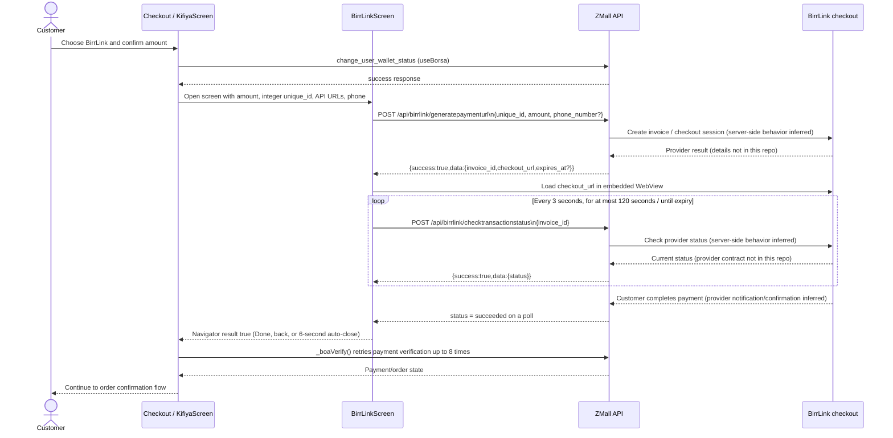

# BirrLink payment flow in ZMall

This guide explains the BirrLink path visible in the ZMall Flutter app. It follows the payment from method selection through verification and order placement, and separates confirmed client behavior from backend behavior that is not present in this repository.

## At a glance



## What happens in the app

1. **Payment method selection.** `KifiyaScreen` reads the selected gateway name and matches the lowercase string `birrlink`. The method tile uses `images/payment/birrlink.png`. The user confirms the amount in a dialog.
2. **Wallet-mode setup.** Before launching the gateway screen, the app calls `useBorsa()`, which posts to `/api/user/change_user_wallet_status`. This helper sets `is_use_wallet` to true only when the selected payment is literally `wallet`; for BirrLink it sends false. This is a shared setup call, not a BirrLink charge.
3. **Payment identity and screen setup.** `orderPaymentUniqueId` is parsed to an `int`; if parsing fails, the app sends `0`. The app passes this `uniqueId`, `price`, the user's phone, and two URLs based on the configured `baseUrl` into `BirrLinkScreen`.
4. **Invoice / hosted checkout request.** On screen initialization, the app POSTs JSON to `/api/birrlink/generatepaymenturl`. It sends `unique_id` and `amount`, plus `phone_number` only if a phone is present. Phone formatting removes punctuation and converts leading `0` or a 9-digit local number to the `251...` format.
5. **Checkout display.** A successful response must have `success: true` and `data`. The screen reads `data.invoice_id`, `data.checkout_url`, and optional `data.expires_at`. It loads the checkout URL inside `InAppWebView`; navigation is currently allowed to continue in the WebView.
6. **Status polling.** Every 3 seconds the app POSTs `{"invoice_id":"..."}` to `/api/birrlink/checktransactionstatus`. A successful response with `data.status == "succeeded"` ends polling and shows a confirmation state. Polling stops after 120 seconds or when the supplied expiry time has passed. Each status request times out after 8 seconds.
7. **Return to Kifiya.** Once confirmed, the screen returns `true` when the user taps Done, presses back, or the six-second auto-close fires. If the user leaves before success, it performs one final status check and returns true only if that status says `succeeded`; otherwise it returns false. Returning false does not invoke `_boaVerify()` in this branch.
8. **ZMall verification / continuation.** On a true result, `KifiyaScreen` calls `_boaVerify()`. That helper calls the app's `boaVerify(...)` payment verification function, retrying up to eight times with three-second gaps if the response is not successful. The successful branch then continues the shared checkout/order flow.

## API contract visible from the client

These are the shapes the app constructs or reads. They are not a complete provider API specification.

### Generate checkout URL

`POST {baseUrl}/api/birrlink/generatepaymenturl`

```json
{
  "unique_id": 123456,
  "amount": 450.0,
  "phone_number": "2519XXXXXXXX"
}
```

`phone_number` is omitted when there is no phone value. The response is treated as successful only when it contains `success: true` and a `data` object. The app reads `invoice_id`, `checkout_url`, and optionally `expires_at` from that object.

### Check transaction status

`POST {baseUrl}/api/birrlink/checktransactionstatus`

```json
{ "invoice_id": "invoice-from-generate-response" }
```

The app expects `success: true` and `data.status`; the only status it treats as paid is the exact string `succeeded`.

## Flutter code walkthrough: the status request

The app constructs the status URL in `KifiyaScreen` and passes it into `BirrLinkScreen`:

```dart
return BirrLinkScreen(
  statusUrl: "$baseUrl/api/birrlink/checktransactionstatus",
  // Other arguments omitted here.
);
```

Inside `BirrLinkScreen`, that value is available as `widget.statusUrl`. This is the actual request code in `_checkTransactionStatus()`:

```dart
Future<String?> _checkTransactionStatus() async {
  if (_invoiceId == null) return null;

  try {
    final http.Response response = await http
        .post(
          Uri.parse(widget.statusUrl),
          headers: <String, String>{
            "Content-Type": "application/json",
            "Accept": "application/json",
          },
          body: json.encode({"invoice_id": _invoiceId}),
        )
        .timeout(const Duration(seconds: 8));

    final data = json.decode(response.body);
    if (data != null && data['success'] == true && data['data'] != null) {
      return data['data']['status'];
    }
  } catch (e) {
    debugPrint("[BirrLinkScreen] checktransactionstatus error: $e");
  }

  return null;
}
```

Read it in this order:

1. `Future<String?>` means this asynchronous function may eventually return a status string, or `null` if it cannot get one.
2. `_invoiceId == null` is a guard. There is no transaction to look up until the generate-payment call has returned an invoice ID.
3. `http.post(...)` creates an HTTP POST request. Its first argument is the destination URL; here `widget.statusUrl` is the value passed by `KifiyaScreen`.
4. `headers` describe the body format. `Content-Type` says the request body is JSON; `Accept` says the client expects JSON back.
5. `json.encode({"invoice_id": _invoiceId})` turns a Dart map into JSON text. For `_invoiceId == "inv-123"`, the request body is `{"invoice_id":"inv-123"}`.
6. `.timeout(Duration(seconds: 8))` limits how long the app waits for this request.
7. `json.decode(response.body)` parses the server's JSON reply into Dart values. The next check reads the reply; it does not send the request body.
8. `return data['data']['status']` gives the status string back to the polling function. Errors are logged and return `null`.

The whole outgoing HTTP request is therefore conceptually:

```http
POST {baseUrl}/api/birrlink/checktransactionstatus
Content-Type: application/json
Accept: application/json

{"invoice_id":"inv-123"}
```

The URL, headers, and body are all arguments to the same `http.post` call. The JSON body is sent because it is passed as the `body:` argument.

## Flutter concepts used by this integration

- **`StatefulWidget` and `State`:** `BirrLinkScreen` stores values that change while payment runs, such as `_invoiceId`, `_checkoutUrl`, loading state, and whether payment is finished.
- **`initState()`:** Called when the screen is first created. It starts `_initiatePayment()` once, which asks the backend for the invoice and checkout URL.
- **`setState()`:** Updates screen state and tells Flutter to rebuild the UI, for example from a spinner to the WebView.
- **`async` / `await`:** Lets the app wait for network requests without blocking the UI thread.
- **`Timer.periodic`:** Runs the status check about every three seconds while the screen is active and payment is pending.
- **`Navigator.push`:** Opens the BirrLink screen. `Navigator.pop(context, true/false)` closes it and returns a result to `KifiyaScreen`.
- **`InAppWebView`:** Displays the hosted checkout page returned by the backend. In this implementation, the app detects success by polling its API, not by inspecting the WebView URL.

## Follow the full Flutter sequence in source

1. `KifiyaScreen` matches the selected gateway name with `"birrlink"` and constructs the payment screen.
2. `BirrLinkScreen.initState()` calls `_initiatePayment()`.
3. `_initiatePayment()` POSTs `unique_id`, `amount`, and optional `phone_number` to the generate URL.
4. The app saves the returned `invoice_id` and `checkout_url`, then starts `_startPolling()`.
5. `_startPolling()` calls `_checkTransactionStatus()` every three seconds.
6. When the result is `succeeded`, the screen returns `true` to `KifiyaScreen`.
7. `KifiyaScreen` calls `_boaVerify()`, which separately checks ZMall's `/admin/check_paid_order` using `order_payment_id`, user ID, and server token.
8. When ZMall verification succeeds, the shared order flow calls `_createOrder()` or its courier/AliExpress variant.

The two status checks serve different roles: BirrLink status polling uses `invoice_id`; ZMall's later order-payment verification uses `order_payment_id` plus the user's credentials.

## What “backend integration” means here

This repository contains the Flutter client, not the implementation behind `/api/birrlink/*`. From the client contract, the server must provide an invoice and checkout URL, retain or retrieve the association between the ZMall `unique_id` and provider `invoice_id`, and return current payment status to the polling endpoint. The diagram's server-to-provider calls are an architectural inference; their exact API, credentials, signatures, webhook handling, persistence, and security checks cannot be verified from this codebase.

The app also makes a separate payment verification call through `boaVerify(...)` after BirrLink reports success. That suggests the client uses one status check against the BirrLink endpoints and then a ZMall order/payment verification step. The exact server-side semantics require the server implementation.

## Important implementation details to understand

- `unique_id` is currently coerced from the order-payment unique ID to an integer, with `0` as fallback. Check that the server expects an integer and that `0` is rejected safely; otherwise a missing/malformed ID could break payment-to-order matching.
- The app trusts the response from its status endpoint as the trigger to proceed. The server must verify payment with the provider and bind the invoice to the original amount/order; the client alone is not proof of payment.
- Polling can stop after two minutes while payment remains pending. In that case the page stays open, but no further automatic polling happens. Returning from the page returns false unless a fresh final check reports `succeeded`.
- Status polling calls continue even while the hosted checkout WebView is open. The WebView itself does not provide the app's success signal in this implementation.
- The initial API call includes no visible user ID, server token, or order-payment ID; its primary correlation field is `unique_id`.
- `useBorsa()` uses the metadata `baseUrl` without the `BASE_URL` fallback used for BirrLink's two endpoints. If metadata `baseUrl` can be empty, check that setup path.
- Debug logging currently prints request payloads, response bodies, invoice IDs, and checkout URLs. Review production logging policy before enabling verbose logs in release builds.

## Code map

| Purpose | File | Where to look |
|---|---|---|
| Gateway tile selection and BirrLink branch | `lib/kifiya/kifiya_screen.dart` | `birrlink` selection around line 1996; open URLs around lines 2088–2090 |
| Invoice request, phone formatting, checkout WebView, polling, result return | `lib/kifiya/components/birrlink_screen.dart` | `_formatPhoneNumber`, `_initiatePayment`, `_startPolling`, `_checkTransactionStatus`, `build` |
| Post-payment verification retry loop | `lib/kifiya/kifiya_screen.dart` | `_boaVerify` around line 718 |
| Shared wallet-mode setup call | `lib/kifiya/kifiya_screen.dart` | `useBorsa` around line 3692 |
| Payment-wide background | `zmall_files/payment/PAYMENT_INTEGRATION_GUIDE.md` | General Kifiya/payment patterns |

## To trace the backend fully

Open the server repository and search for `birrlink/generatepaymenturl` and `birrlink/checktransactionstatus`. Follow each route into its service/provider client and database model. Confirm how provider notifications/webhooks are authenticated, how invoice ID maps to the ZMall payment/order ID, how amount and currency are checked, what statuses can be returned, and how `boaVerify` changes the order/payment state. Those details are not available in this app repository.
